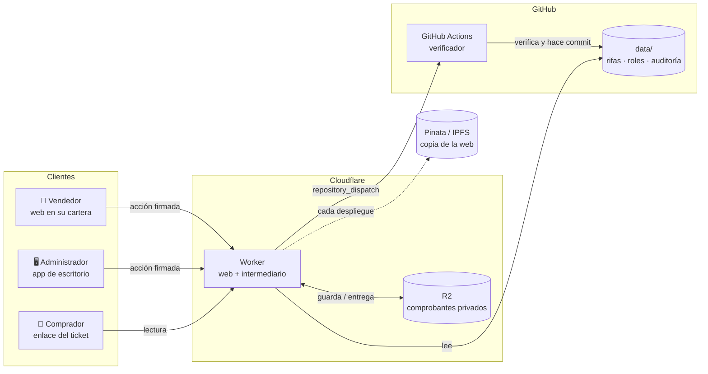
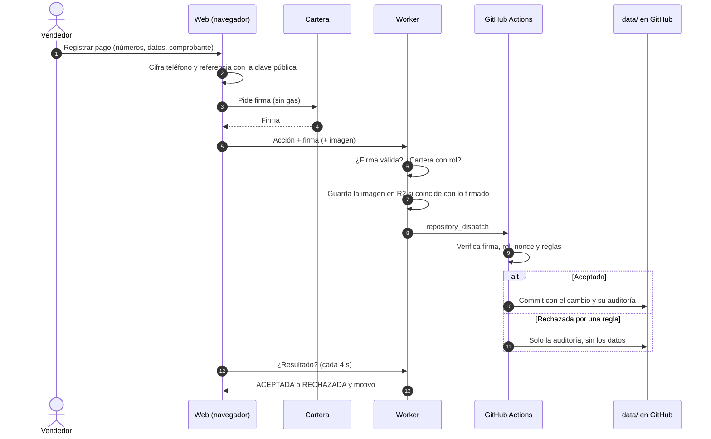
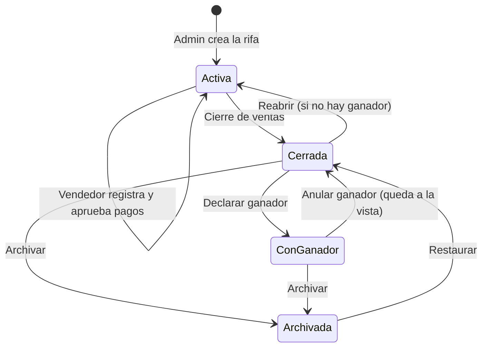
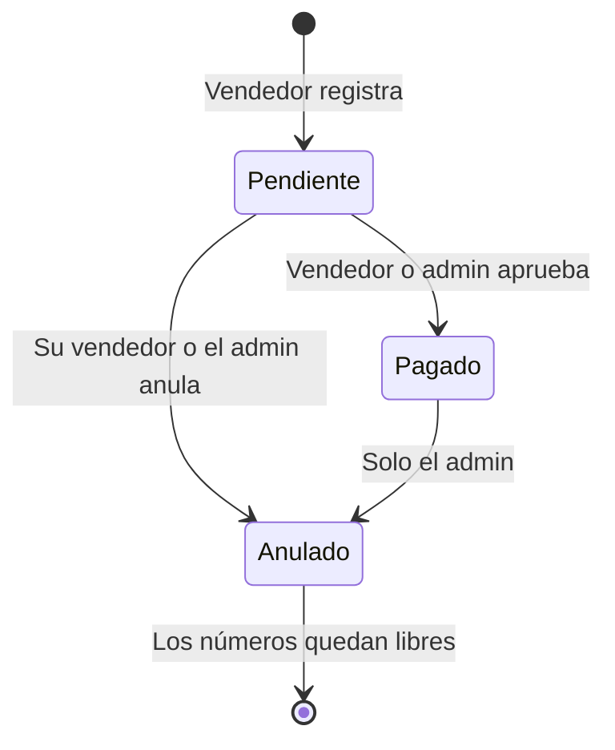
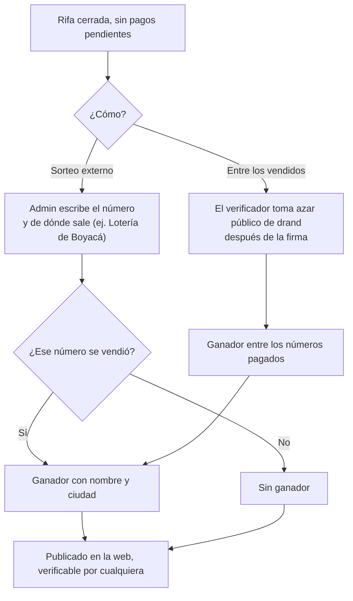
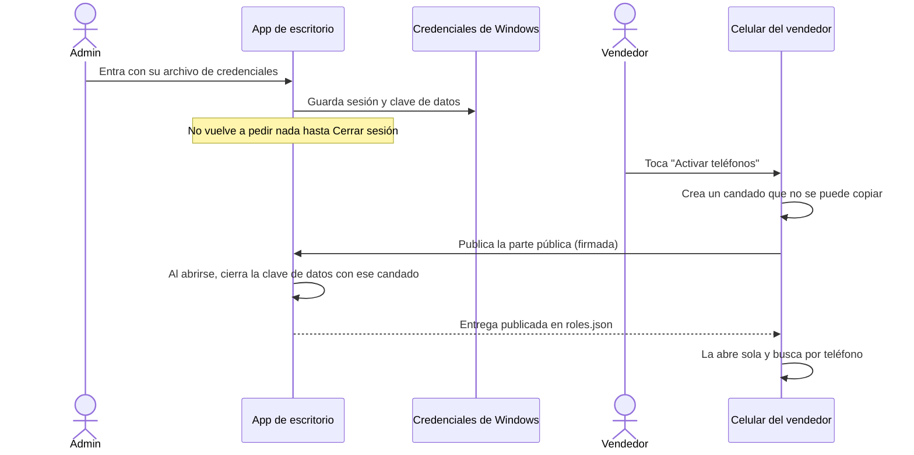

# Sorteos y Rifas Web3

Plataforma de rifas sin servidor propio ni base de datos. Los datos viven en este repositorio,
cada cambio lo firma una cartera autorizada (MetaMask, Trust Wallet) y GitHub Actions lo
verifica antes de guardarlo. Proyecto independiente, derivado de
[PlataformasSorteosYRifas](https://github.com/jhonsu01/PlataformasSorteosYRifas).

**Web:** https://sorteos-web3.aliciagadiaz29304.workers.dev

| Quién | Qué usa | Qué puede hacer |
| --- | --- | --- |
| Administrador | App de escritorio (Windows) | Rifas, vendedores, administradores, pagos, comprobantes, ganadores |
| Vendedor | Web, dentro de su cartera | Registrar y aprobar pagos de sus rifas, buscar clientes, anular sus pendientes |
| Comprador | Enlace del ticket | Ver sus números y compartir el ticket |

Para instalarlo en otra cuenta, sigue [docs/GUIA-DESPLIEGUE.md](docs/GUIA-DESPLIEGUE.md).
Para el día a día del administrador, [docs/GUIA-ADMINISTRADORES.md](docs/GUIA-ADMINISTRADORES.md).

## Cómo funciona

Los diagramas se pueden acercar, alejar y mover con los botones que GitHub muestra sobre cada uno.

### Arquitectura



- **Worker:** sirve la web y guarda el token de GitHub. Solo deja pasar acciones firmadas por
  carteras con rol, para que nadie gaste los minutos de Actions con basura.
- **Verificador:** vuelve a comprobar todo: firma, rol, vigencia, que no se repita y las reglas
  del negocio. Es el único que escribe en `data/`.
- **R2:** comprobantes de pago. Solo los ve una cartera autorizada para esa rifa.

### Un cambio firmado, de principio a fin



Tarda entre 15 y 30 segundos. Si dos vendedores registran el mismo número a la vez, el segundo
se rechaza.

### Ciclo de una rifa



### Un pago



### Ganador



### Sesión del administrador y clave para vendedores



## Privacidad

El repositorio es público y su historial no se borra.

- **Público:** números, nombre con la inicial del apellido ("Ana G."), ciudad, estado y auditoría firmada.
- **Cifrado:** teléfono, nombre completo y referencia de pago. Solo los lee quien tenga la clave de datos.
- **Privado en R2:** imágenes de los comprobantes.
- **Rechazos:** una acción rechazada no publica sus datos, solo su huella.

## Estructura

| Ruta | Qué es |
| --- | --- |
| `services/verificador` | Reglas y verificación de firmas; se ejecuta en GitHub Actions |
| `services/relay` | Cloudflare Worker: web, intermediario y comprobantes |
| `apps/web3` | Web de vendedores y tickets |
| `apps/escritorio` | App del administrador (Tauri, instalador MSI); su interfaz también está en `/admin/` |
| `data` | Rifas, roles, auditoría: lo escribe solo el verificador |
| `execution` | Configurar, inicializar, desplegar y pruebas de punta a punta |
| `docs` | Guías de administración y de despliegue |

## Comandos

```bash
cd services/verificador && npm ci && npm test
```

```bash
cd apps/web3 && npm ci && npm test
```

```bash
node execution/desplegar.mjs
```

```bash
cd apps/escritorio && npx tauri build
```

Licencia MIT.
